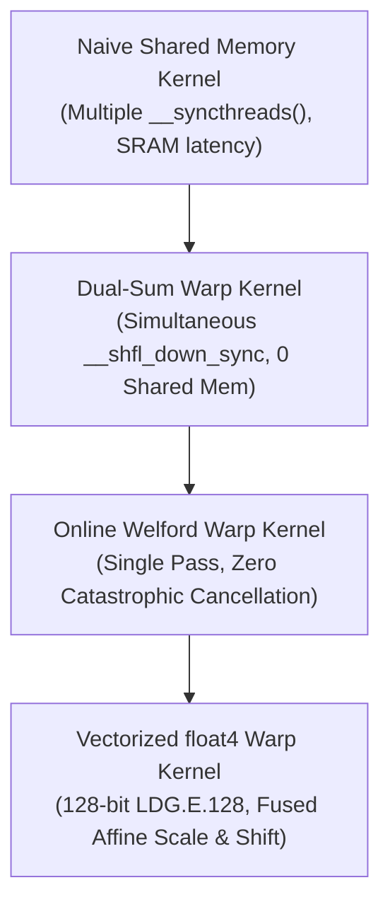
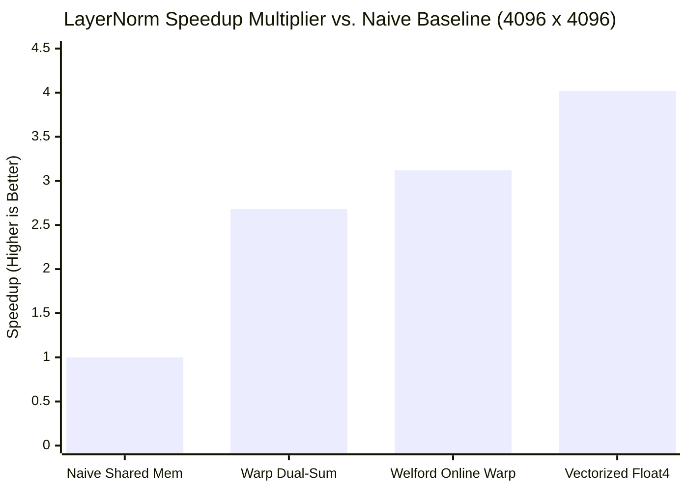

# LayerNorm Optimization: Dual-Sum Reductions, Welford's Algorithm & Vectorized Warps

## 1. Layer Normalization in Transformer Networks

Layer Normalization (LayerNorm), introduced by Ba, Kiros, and Hinton (2016), normalizes activations across the feature/channel dimension for each individual training example:

$$\text{LayerNorm}(x) = \frac{x - \mu}{\sqrt{\sigma^2 + \epsilon}} \odot \gamma + \beta$$

Where:
- $x \in \mathbb{R}^D$ is the input activation vector.
- $\mu \in \mathbb{R}$ is the scalar mean of row $x$.
- $\sigma^2 \in \mathbb{R}$ is the scalar variance of row $x$.
- $\epsilon > 0$ is a small constant (e.g., $10^{-5}$) ensuring division-by-zero stability.
- $\gamma \in \mathbb{R}^D$ and $\beta \in \mathbb{R}^D$ are learnable affine gain and bias parameters.

In Transformers, LayerNorm is invoked at the input and output of every Self-Attention and Multi-Layer Perceptron (MLP) block. Accelerating LayerNorm directly reduces the latency floor of modern LLM inference.

---

## 2. Statistical Formulations & Numerical Precision

### 2.1 The Two-Pass & Dual-Sum Formulations
The textbook formula computes the mean in Pass 1 and variance in Pass 2:
$$\mu = \frac{1}{D} \sum_{j=0}^{D-1} x_j, \quad \sigma^2 = \frac{1}{D} \sum_{j=0}^{D-1} (x_j - \mu)^2$$

In our **Dual-Sum Warp kernel**, we compute $\sum x$ and $\sum x^2$ simultaneously in a single loop by exploiting the algebraic equivalence:
$$\sigma^2 = \frac{1}{D} \sum_{j=0}^{D-1} x_j^2 - \mu^2$$

This allows computing both sums in **parallel warp shuffle instructions** without any inter-pass barrier synchronization.

### 2.2 Catastrophic Cancellation & The Online Welford Algorithm
When activations have a large DC offset (e.g., $\mu \approx 1000.0$) and a small variance ($\sigma^2 \approx 1.0$), computing:
$$\frac{1}{D} \sum x_j^2 - \mu^2 \approx 10^6 - 10^6$$
causes **catastrophic subtractive cancellation** in IEEE 754 FP32, which only has 24 bits of mantissa precision ($\approx 7$ decimal digits). This can result in severe precision loss or even an erroneous negative variance!

To solve this, we implemented **Parallel Welford Warp Reduction**:
Given two subsets of data $A$ and $B$:
$$n = n_A + n_B$$
$$\delta = \mu_B - \mu_A$$
$$\mu = \mu_A + \delta \left(\frac{n_B}{n}\right)$$
$$M_2 = M_{2,A} + M_{2,B} + \delta^2 \left(\frac{n_A n_B}{n}\right)$$

Where $M_2 = \sum (x_i - \mu)^2$. This formulation guarantees complete numerical stability and never evaluates difference of large squares.

---

## 3. Kernel Optimization Hierarchy

### Architectural Highlights of the Vectorized Float4 Kernel:
1. **128-bit Memory Transactions**: Loads four contiguous 32-bit floating-point values in a single instruction (`float4`), perfectly matching GPU memory transaction burst widths.
2. **Fused Scale & Bias**: Computes affine multiplication by $\gamma$ and addition of $\beta$ directly inside register accumulators before writing back to global memory.
3. **Register Reuse**: Mean $\mu$ and inverse standard deviation `inv_std` are broadcast to all 32 lanes via `__shfl_sync(FULL_MASK, ..., 0)`, eliminating shared memory lookups entirely.

---

## 4. Benchmark Performance Metrics

