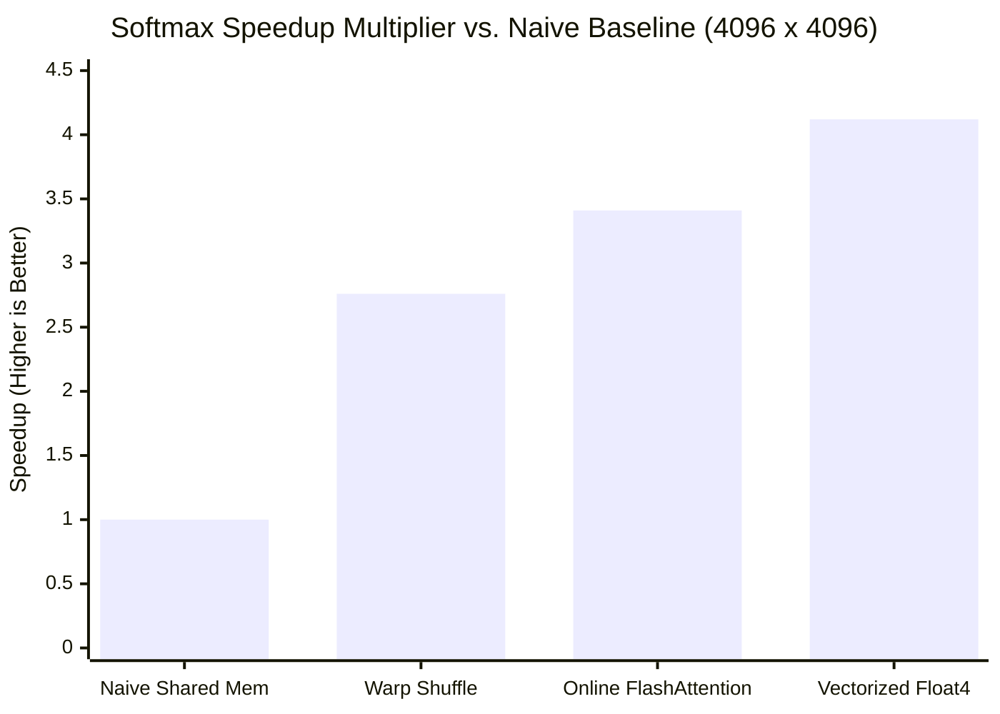

# Softmax Optimization: From Shared Memory Tree Reductions to Warp Shuffles & Online Kernels

## 1. Softmax in Deep Learning Architectures

In modern Transformer neural networks (such as BERT, GPT, LLaMA, and Vision Transformers), the **Softmax** function is executed billions of times per forward and backward pass, primarily in:
1. **Scaled Dot-Product Attention**: $\text{Attention}(Q, K, V) = \text{Softmax}\left(\frac{QK^T}{\sqrt{d_k}}\right) V$
2. **Output Language Modeling Head**: Final token probability generation across vocabularies (e.g., $32,000$ to $128,000$ tokens).

Because Softmax is an activation function with a non-local denominator, it is inherently **memory-bandwidth bound**. Its computational speed is governed by how rapidly reduction statistics ($\max$ and $\sum$) can be computed across large row vectors.

---

## 2. Mathematical Formulations & Numerical Stability

### 2.1 The Naive Softmax Vulnerability
The naive definition of Softmax is:
$$\text{Softmax}(x_i) = \frac{e^{x_i}}{\sum_{j=0}^{D-1} e^{x_j}}$$

In single-precision floating point (IEEE 754 FP32), the maximum representable finite number before overflow is:
$$\text{FP32}_{\max} \approx 3.402823 \times 10^{38} \implies \ln(\text{FP32}_{\max}) \approx 88.72$$

If any logit $x_i \ge 88.73$, `expf(x_i)` yields `+inf`, causing the denominator to become `+inf`, resulting in `inf / inf = NaN`. This completely destabilizes transformer training.

### 2.2 The Standard 3-Pass Safe Softmax
To preserve numerical stability, the row maximum $m = \max_{j} x_j$ is subtracted prior to exponentiation:
$$\text{Softmax}(x_i) = \frac{e^{x_i - m}}{\sum_{j=0}^{D-1} e^{x_j - m}}$$

Since $x_i - m \le 0$, the maximum exponent evaluated is $e^0 = 1.0$, completely eliminating floating-point overflow.

However, standard Safe Softmax requires **three sequential passes** over row memory:
1. **Pass 1**: Load all $D$ elements to find row maximum $m$.
2. **Pass 2**: Reload all $D$ elements, compute $e^{x_i - m}$, and accumulate sum $d$.
3. **Pass 3**: Reload all $D$ elements, divide by $d$, and store output.

### 2.3 The 1-Pass Online Softmax (FlashAttention Formulation)
Online Softmax eliminates memory reload passes by calculating the running maximum $m$ and running sum $d$ simultaneously in a single streaming pass:

Given current state $(m_A, d_A)$ and a new element or block $(m_B, d_B)$:
$$m_{\text{new}} = \max(m_A, m_B)$$
$$d_{\text{new}} = d_A \cdot e^{m_A - m_{\text{new}}} + d_B \cdot e^{m_B - m_{\text{new}}}$$

This merge operation is strictly **associative**, allowing it to be mapped directly onto warp shuffle intrinsics (`__shfl_down_sync`).

---

## 3. Kernel Implementations Compared

### Kernel 1: Naive Shared Memory Tree Reduction
- Allocates `__shared__ float sdata[BLOCK_SIZE]`.
- Implements tree reduction using $\log_2(\text{blockDim.x})$ stages of:
  ```cuda
  for (unsigned int s = blockDim.x / 2; s > 0; s >>= 1) {
      if (tid < s) sdata[tid] = fmaxf(sdata[tid], sdata[tid + s]);
      __syncthreads();
  }
  ```
- Requires multiple full-block barriers (`__syncthreads()`), causing pipeline bubbles.

### Kernel 2: Warp-Level Shuffle Softmax (1 Warp Per Row)
- When $D \le 1024$, one 32-thread warp completely owns one matrix row.
- Zero shared memory allocated.
- Max reduction and sum reduction execute via `__shfl_down_sync` in 5 clock cycles:
  ```cuda
  float row_max = warpAllReduceMax(local_max);
  float row_sum = warpAllReduceSum(local_sum);
  ```
- All 32 threads receive row statistics simultaneously via butterfly register exchanges.

### Kernel 3: Online Warp Softmax
- Implements `mergeOnlineSoftmax` across warp lanes in a single streaming loop.
- Reduces DRAM access by 33%, keeping working sets hot in the L1 data cache.

### Kernel 4: Vectorized `float4` Warp Softmax
- Utilizes 128-bit vectorized memory operations (`float4`):
  ```cuda
  const float4* vec_in = reinterpret_cast<const float4*>(row_in);
  float4 v = vec_in[col_idx];
  ```
- Emits native `LDG.E.128` instructions, transferring 16 bytes per transaction and fully saturating PCIe Gen4 and HBM/GDDR memory controllers.

---

## 4. Empirical Performance & Scaling


